# Ponarch

**Notch desktop interaktif untuk Arch Linux dan Hyprland, didukung
Quickshell.**

Ponarch menghadirkan antarmuka desktop ringkas dan interaktif untuk
Hyprland. Dibangun dengan Quickshell dan QML, Ponarch menggabungkan
informasi sistem, kontrol media, notifikasi, aksi cepat, serta berbagai
utilitas sehari-hari dalam satu antarmuka bergaya notch.

> Dokumentasi bahasa Inggris: [README.md](README.md)

## Tangkapan layar

Tangkapan layar berikut menampilkan beberapa keadaan utama Ponarch. Mode
Glass menggunakan permukaan transparan berwarna, blur compositor, dan
highlight bagian dalam yang halus.

| Ringkas | Dashboard |
| --- | --- |
|  | 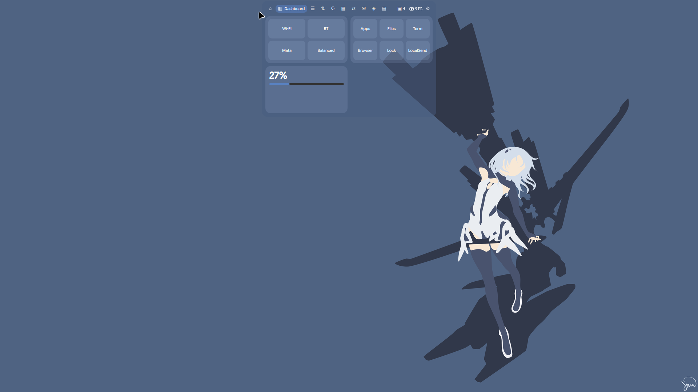 |

| Pengaturan | Notifikasi |
| --- | --- |
| 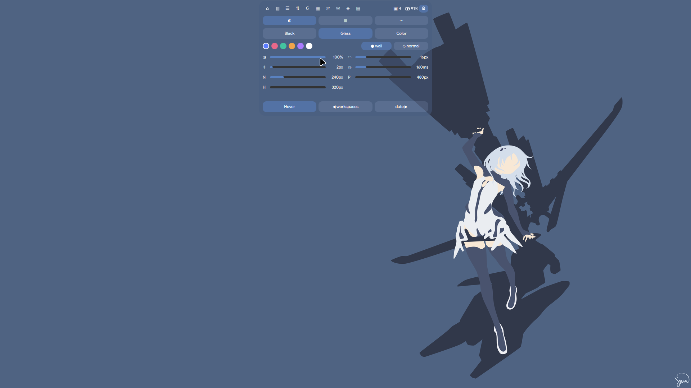 | 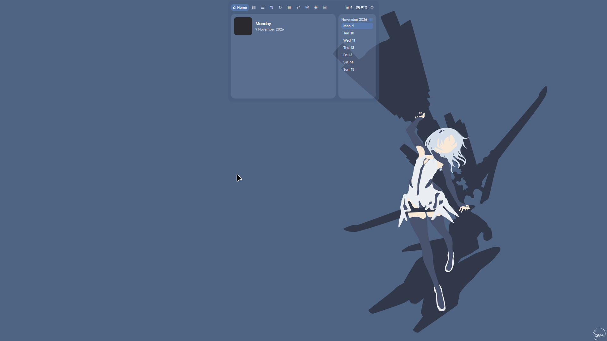 |

### Fitur

Setiap tab fitur yang tersedia ditampilkan secara terpisah di bawah ini.

| Fitur | Screenshot | Fitur | Screenshot |
| --- | --- | --- | --- |
| Home | 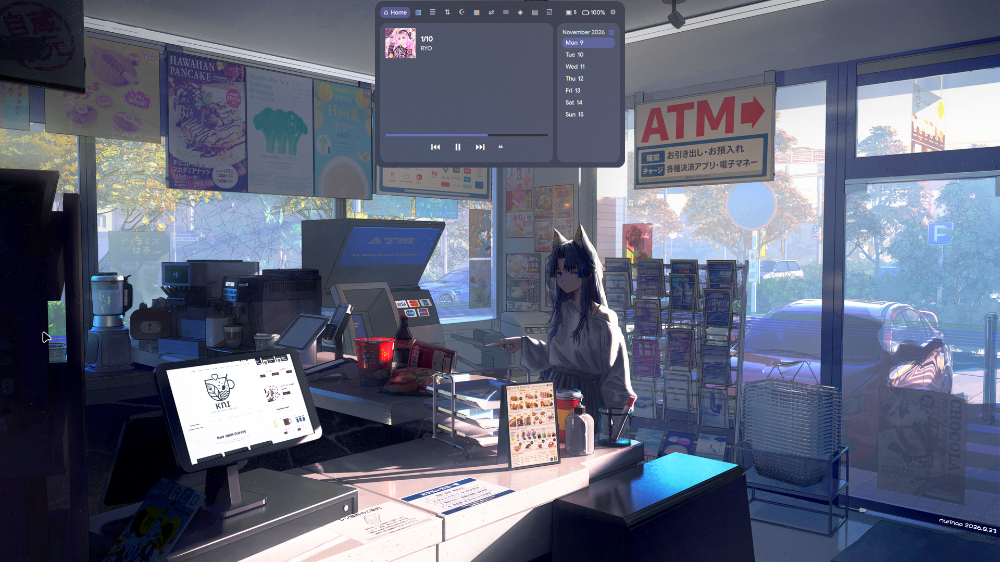 | Dashboard |  |
| Control | 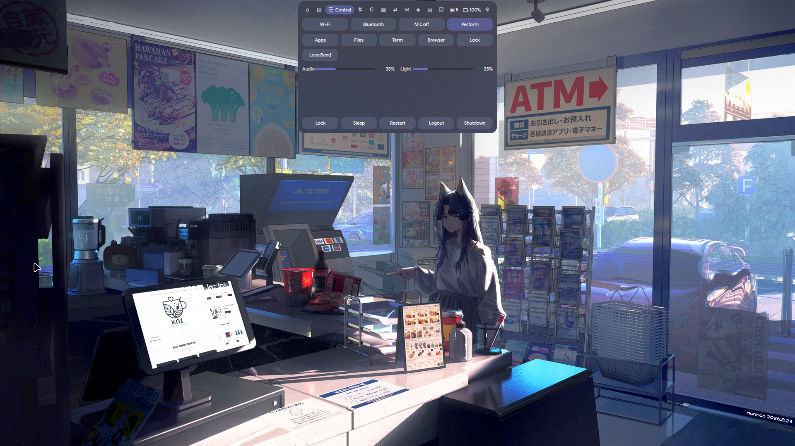 | Wi-Fi & Bluetooth |  |
| Todo | 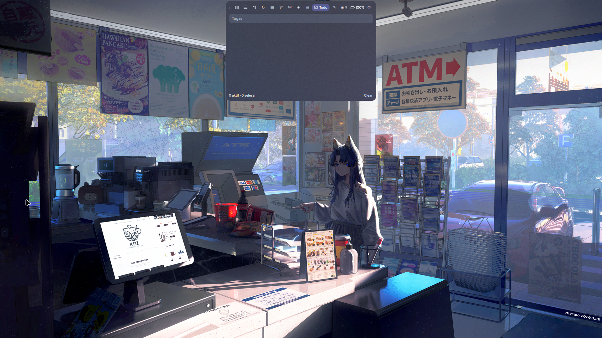 | Notes |  |
| Pomodoro | 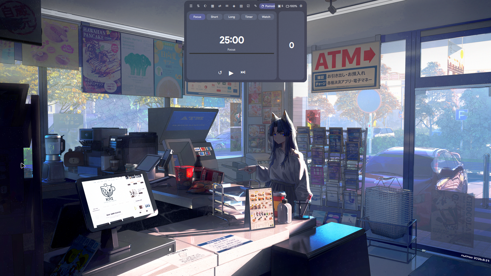 | Weather |  |
| Prayer Times | 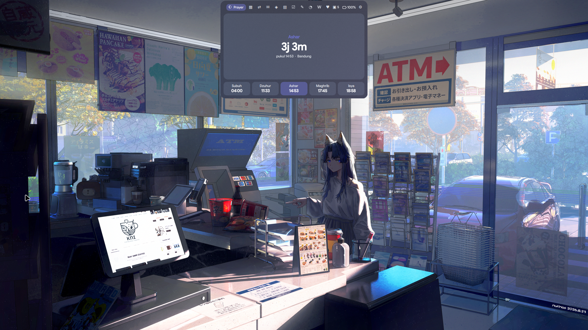 | Health | 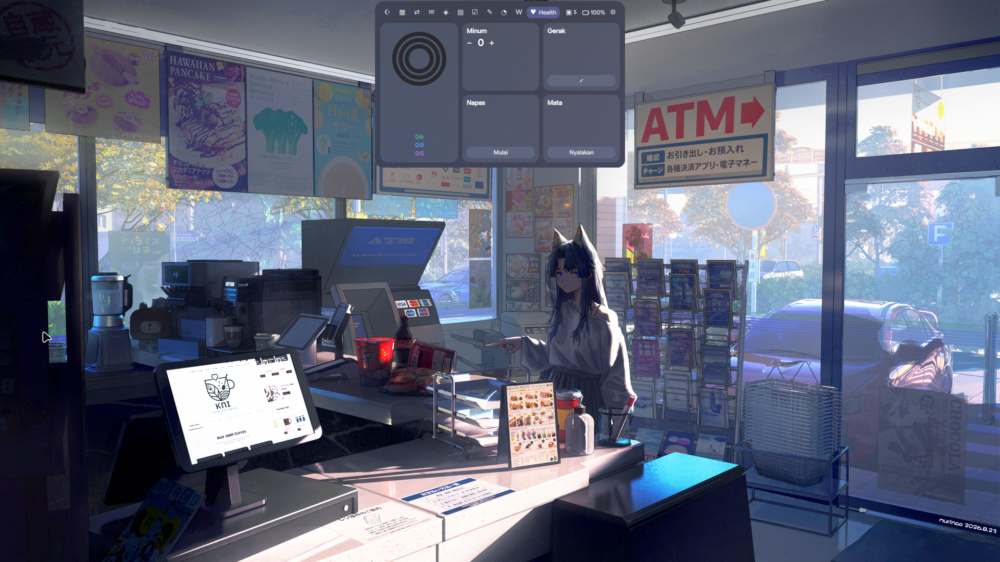 |
| Day |  | Calendar |  |
| AI Chat |  | Translate |  |
| Shelf |  | Notifications | 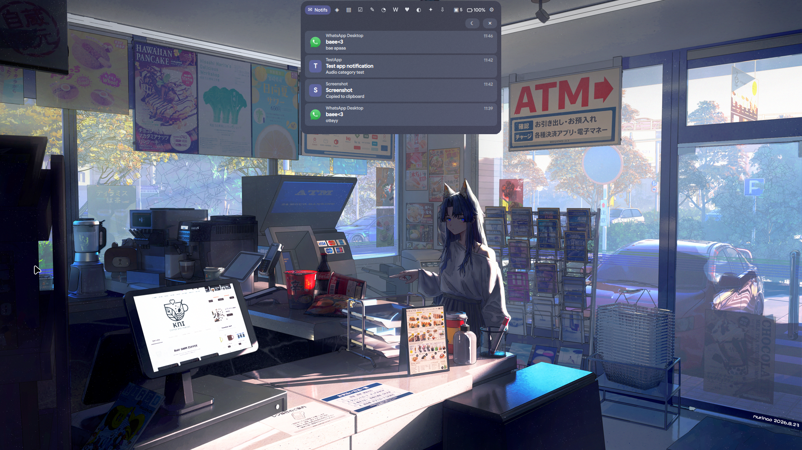 |
| GitHub PRs |  | Screen Time |  |
| System |  | Buddy |  |
| Settings | 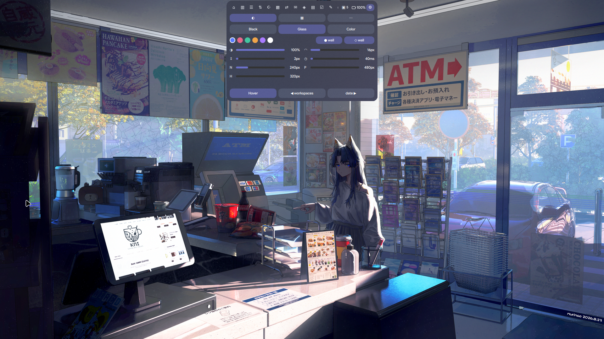 | Tray |  |

### Media, visualizer, dan notifikasi

Media yang diputar menempatkan sampul album, visualizer CAVA, dan lirik
tersinkronisasi pada slot ringkas yang terpisah agar tidak saling tumpang
tindih. Suara notifikasi dibedakan berdasarkan event: pesan aplikasi biasa
menggunakan `message-new-instant`, peringatan menggunakan `dialog-warning`,
error menggunakan `dialog-error`, dan event screenshot/capture
menggunakan `complete`.

Notifikasi screenshot dicatat tanpa membuka toast secara default agar
notifikasi capture tidak muncul pada screenshot berikutnya. Perilaku ini
dapat diaktifkan melalui Settings sebagai **Popup screenshot**.

| Keadaan | Screenshot | Keadaan | Screenshot |
| --- | --- | --- | --- |
| Notch media dengan CAVA |  | Popup notifikasi |  |
| HUD volume |  | HUD kecerahan |  |

## Fitur

Ponarch memiliki dua keadaan antarmuka utama: notch ringkas untuk
informasi yang sering digunakan dan antarmuka yang diperluas dengan
berbagai alat serta modul tambahan.

### Notch ringkas

- Jam dan tanggal.
- Informasi media yang sedang diputar serta sampul album.
- Visualizer audio yang didukung CAVA.
- Lirik tersinkronisasi.
- Indikator progres Pomodoro.
- HUD volume dan kecerahan.
- Popup notifikasi desktop.

### Antarmuka yang diperluas

Tab dapat dinonaktifkan dan diurutkan ulang sesuai alur kerja.

| Tab | Deskripsi |
| --- | --- |
| Home | Pemutar musik dan kalender dengan tampilan mingguan atau bulanan. |
| Dashboard | Ringkasan informasi desktop. |
| Control | Kontrol cepat dan peluncur aplikasi yang dapat dikonfigurasi. |
| Wi-Fi & Bluetooth | Kontrol jaringan dan Bluetooth. |
| Todo | Pengelolaan tugas. |
| Notes | Catatan cepat. |
| Pomodoro | Timer fokus dan pelacakan sesi. |
| Weather | Informasi cuaca berdasarkan lokasi. |
| Prayer Times | Jadwal salat berdasarkan lokasi dan metode perhitungan. |
| Health | Informasi terkait kesehatan pribadi. |
| Day | Ringkasan harian. |
| Calendar | Integrasi iCal dan Google Calendar. |
| AI Chat | Antarmuka chat AI yang dapat dikonfigurasi. |
| Translate | Utilitas penerjemahan. |
| Shelf | Rak berkas dengan dukungan drag-and-drop. |
| Notifications | Riwayat dan kontrol notifikasi. |
| GitHub PRs | Ringkasan pull request menggunakan GitHub CLI. |
| Screen Time | Pelacakan penggunaan aplikasi. |
| System | Pemantauan sumber daya dengan bar ringkas atau angka detail. |
| Buddy | Teman pendamping desktop. |
| Tray | Aplikasi system tray dan menu konteks. |

### System tray

- Klik kiri untuk mengaktifkan aplikasi.
- Klik kanan untuk membuka menu konteks, termasuk submenu.
- Klik tengah untuk menjalankan aksi sekunder.

### Daemon notifikasi

Ponarch dapat bertindak sebagai daemon notifikasi desktop dan menggantikan
SwayNC, Mako, atau Dunst. Fitur yang didukung meliputi ikon dan gambar
aplikasi, tombol aksi notifikasi, mode Jangan Ganggu, serta popup
notifikasi yang terintegrasi dengan notch.

Suara notifikasi menggunakan suara desktop `message-new-instant` dan dapat
diaktifkan atau dinonaktifkan dengan `"notifSound": true` di
`~/.config/ponarch/settings.json` atau melalui Settings. Hentikan daemon
notifikasi lain sebelum menjadikan Ponarch daemon utama. Untuk tetap
menggunakan daemon yang ada, atur `"notifDaemon": false`.

### Layanan lokasi

Informasi cuaca dan waktu salat dapat menggunakan lokasi perkiraan berbasis
IP atau lokasi yang dikonfigurasi secara manual. Lokasi manual menerima
tautan Google Maps, koordinat lintang dan bujur, atau nama tempat yang
dicari melalui OpenStreetMap Nominatim.

### Tema dan tampilan

Ponarch menyediakan tiga tema:

- **Black** — tampilan gelap dan minimal.
- **Glass** — permukaan transparan dengan efek blur.
- **Color** — gaya berbasis warna aksen.

Warna aksen dapat diambil dari wallpaper saat ini. Tint Glass juga dapat
menyesuaikan wallpaper atau aplikasi yang sedang difokuskan.

## Persyaratan

| Komponen | Persyaratan |
| --- | --- |
| Compositor | Hyprland |
| Shell runtime | Quickshell (`quickshell`, `quickshell-git`, atau fork yang kompatibel) |
| Qt | Quickshell harus dibangun dengan versi Qt yang terpasang di sistem |
| Alat wajib | `bash`, `curl` |

Ponarch menggunakan `Quickshell.Hyprland`; compositor Wayland lain belum
didukung.

### Dependensi opsional

| Paket | Kegunaan |
| --- | --- |
| `brightnessctl` | Kontrol kecerahan layar |
| `networkmanager` | Pengelolaan jaringan |
| `power-profiles-daemon` | Integrasi profil daya |
| `libnotify` | Kompatibilitas notifikasi |
| `imagemagick` | Ekstraksi warna wallpaper dan aplikasi |
| `python` | Integrasi Google Calendar |
| `github-cli` | Integrasi pull request GitHub |
| `localsend` | Berbagi berkas lokal |
| `waybar` | Integrasi Waybar untuk `ponarch mode` |
| `zip`, `libarchive` | Penanganan arsip |
| `zenity` | Dialog grafis |

**Kompatibilitas Qt penting.** Jika Quickshell melaporkan bahwa Quickshell
dibangun dengan versi Qt yang berbeda dari versi yang terpasang, bangun
ulang atau pasang ulang Quickshell dengan instalasi Qt saat ini. Perbedaan
versi dapat menyebabkan crash.

## Instalasi

### Arch Linux

Bangun paket dari sumber saat ini:

```bash
cd ~/Downloads
tar xf ponarch-quickshell-1_0_0-20.tar.gz
cd ponarch
grep pkgrel PKGBUILD
makepkg -si
```

Jalankan Ponarch:

```bash
pkill -f 'qs.*-p /usr/share/ponarch' 2>/dev/null || true
ponarch start
```

Setelah instalasi, tambahkan keybinding dari
`/usr/share/doc/ponarch/hypr-ponarch.conf` ke `hyprland.conf`.

Jika melakukan upgrade dari paket lama, hentikan runtime lama terlebih
dahulu:

```bash
pkill -f 'qs.*-p /usr/share/poni' 2>/dev/null || true
ponarch start
```

### Tombol laptop dan perilaku lid

Tombol kecerahan menggunakan IPC Ponarch dengan `brightnessctl` sebagai
fallback. Tombol `XF86Display` mengganti mode Ponarch/Waybar jika firmware
menyediakan Fn+F5 sebagai simbol tersebut. Jika Fn+F5 menghasilkan simbol
lain, periksa dengan `wev` lalu tambahkan simbol yang sesuai ke keybind
Hyprland.

Kebijakan logind yang disarankan:

```ini
HandleLidSwitch=suspend
HandleLidSwitchExternalPower=suspend
HandleLidSwitchDocked=suspend
```

Periksa sensor dan inhibitor dengan:

```bash
cat /proc/acpi/button/lid/LID0/state
loginctl list-inhibitors
```

### Distribusi lain

Untuk distribusi yang tidak memiliki paket:

```bash
git clone https://github.com/hnxzl/ponarch.git
cd ponarch

mkdir -p ~/.local/share/ponarch
cp qml/* gcal.py ~/.local/share/ponarch/

install -Dm755 ponarch ~/.local/bin/ponarch
```

Jalankan aplikasi:

```bash
PONARCH_DIR="$HOME/.local/share/ponarch" ponarch start
```

Agar tidak perlu menentukan `PONARCH_DIR` setiap kali, ekspor variabel
tersebut di profil shell.

## Perintah

Ponarch menyediakan antarmuka command-line untuk mengontrol notch dan
layanannya.

```bash
ponarch start | stop | restart | notch | toggle | show | hide | vis
ponarch tab <name>
ponarch mode | localsend | gcal | edit | mem | status
```

| Perintah | Deskripsi |
| --- | --- |
| `ponarch start` | Menjalankan Ponarch. |
| `ponarch stop` | Menghentikan Ponarch. |
| `ponarch restart` | Memulai ulang Ponarch. |
| `ponarch notch` | Membuka atau menutup notch. |
| `ponarch toggle` | Mengubah visibilitas notch. |
| `ponarch show` | Menampilkan notch. |
| `ponarch hide` | Menyembunyikan notch. |
| `ponarch vis` | Mengontrol visibilitas. |
| `ponarch tab <name>` | Membuka tab tertentu. |
| `ponarch mode` | Beralih antara mode Waybar penuh dan Ponarch. |
| `ponarch localsend` | Menjalankan integrasi LocalSend. |
| `ponarch gcal` | Mengonfigurasi integrasi Google Calendar. |
| `ponarch edit` | Membuka berkas pengaturan. |
| `ponarch mem` | Menampilkan penggunaan memori berdasarkan PSS. |
| `ponarch status` | Menampilkan status aplikasi. |

Nama tab yang tersedia:

```text
home dash control net todo notes pomo weather prayer
health day cal ai trans shelf notif gh screen system
buddy tray settings
```

Contoh:

```bash
ponarch tab tray
ponarch tab weather
ponarch tab settings
```

Notch juga dapat diganti melalui keybinding Hyprland. Binding bawaan yang
disarankan adalah `Alt+N`.

## Konfigurasi

Sebagian besar pengaturan dapat dikelola melalui tab Settings. Berkas
konfigurasi berada di:

```text
~/.config/ponarch/settings.json
```

Saat dijalankan setelah upgrade, Ponarch akan menyalin
`~/.config/poni/settings.json` ke lokasi baru satu kali agar preferensi
pengguna tetap terjaga.

Buka berkas tersebut dengan:

```bash
ponarch edit
```

### Pengaturan yang tersedia

| Kunci | Deskripsi |
| --- | --- |
| `mode` | Tema visual: Black, Glass, atau Color. |
| `accent` | Warna aksen. |
| `glassOpacity` | Opasitas permukaan Glass. |
| `radius` | Radius sudut antarmuka. |
| `gap` | Jarak antar elemen antarmuka. |
| `notchWidth` | Lebar notch yang diciutkan dalam piksel. |
| `panelWidth` | Lebar panel kontrol yang diperluas. |
| `panelHeight` | Tinggi panel kontrol yang diperluas. |
| `weatherDashboard` | Menampilkan atau menyembunyikan tile cuaca di Dashboard tanpa menonaktifkan tab Weather. |
| `leftSlot` | Konten sisi kiri notch yang diciutkan. |
| `rightSlot` | Konten sisi kanan notch yang diciutkan. |
| `homeCal` | Tata letak kalender: `week` atau `month`. |
| `sysDetail` | Tampilan tab System: `false` untuk bar, `true` untuk angka detail. |
| `autoLocation` | Mengaktifkan atau menonaktifkan lokasi otomatis berbasis IP. |
| `prayerMethod` | Metode perhitungan Aladhan; default `20` (Kemenag Indonesia). |
| `launchers` | Peluncur aplikasi khusus di tab Control. |
| `tabs` | Tab yang aktif dan urutan tampilnya. |
| `aiProvider` | Penyedia layanan AI. |
| `aiModel` | Identitas model AI. |
| `aiBase` | URL dasar layanan AI. |

### Slot notch

Sisi kiri dan kanan notch yang diciutkan dapat menampilkan informasi
berbeda. Jenis slot yang tersedia:

```text
workspaces
battery
date
pomodoro
prayer
weather
event
```

### Peluncur khusus

Tab Control mendukung peluncur khusus melalui konfigurasi `launchers`.

```json
{
  "launchers": [
    {
      "label": "Terminal",
      "cmd": "kitty"
    },
    {
      "label": "Browser",
      "cmd": "brave"
    }
  ]
}
```

### Konfigurasi lokasi

Deteksi lokasi otomatis menggunakan `ipwho.is`, lalu `ipapi.co` sebagai
fallback. Geolokasi berbasis IP umumnya hanya akurat pada tingkat kota dan
dapat dipengaruhi VPN atau routing jaringan.

Untuk lokasi manual:

```json
{
  "autoLocation": false,
  "city": "Bandung",
  "lat": -6.9175,
  "lon": 107.6191
}
```

Tautan Google Maps, koordinat, atau nama tempat juga dapat diberikan di tab
Prayer. Nama tempat dicari melalui OpenStreetMap Nominatim.

### Perhitungan waktu salat

Jadwal salat menggunakan API Aladhan. Metode bawaan adalah:

```json
{
  "prayerMethod": 20
}
```

Metode `20` adalah metode Kementerian Agama Republik Indonesia. Ubah nilai
ini sesuai lokasi dan metode perhitungan yang diinginkan.

### AI Chat

Penyedia AI yang dapat dikonfigurasi:

```text
claude
gemini
openai
ollama
```

Konfigurasikan provider, model, dan base URL melalui pengaturan. Simpan
API key di:

```text
~/.config/ponarch/ponarch.env
```

Contoh:

```bash
PONARCH_AI_KEY=your_api_key
```

Jaga berkas ini tetap privat dan jangan commit ke version control.

## Integrasi Google Calendar

Ponarch dapat menampilkan event Google Calendar di notch.

```bash
ponarch gcal
```

Ikuti instruksi konfigurasi. Persyaratannya:

1. Buat project Google Cloud.
2. Aktifkan Google Calendar API.
3. Konfigurasikan OAuth client dengan tipe aplikasi **Desktop app**.
4. Selesaikan alur otorisasi OAuth.

Untuk otorisasi yang lebih lama, konfigurasikan consent screen dengan
tepat. Google dapat mencabut refresh token dalam kondisi tertentu.
Sebagai alternatif, tambahkan URL iCal privat melalui konfigurasi
`calendars`. Perlakukan URL iCal privat seperti kredensial dan jangan
membagikannya secara publik.

## Penggunaan sumber daya

Ponarch dirancang untuk membatasi aktivitas latar belakang saat fitur tidak
digunakan:

- Hanya tab aktif yang dimuat; isi tab dibongkar saat notch ditutup.
- Tugas latar belakang hanya dijalankan untuk fitur yang diaktifkan.
- CAVA hanya berjalan saat musik diputar dan notch diciutkan.
- Timer cuaca dan waktu salat hanya berjalan saat informasinya ditampilkan
  pada slot.
- Timer kalender hanya berjalan jika integrasi kalender dikonfigurasi.
- Data screen time hanya ditulis saat nilai yang relevan berubah.
- Kecerahan diperiksa setiap dua detik.
- Visualizer menggunakan satu timer fallback.

Rendering software eksperimental dapat diaktifkan dengan:

```bash
PONARCH_SOFTWARE=1
```

Tambahkan ke `~/.config/ponarch/ponarch.env`. Opsi ini menonaktifkan
konteks rendering GPU biasa dan belum tentu meningkatkan performa di
setiap sistem.

Untuk mengukur penggunaan memori:

```bash
ponarch mem
```

Perintah tersebut melaporkan penggunaan berdasarkan proportional set size
(PSS), bukan hanya resident memory.

## Catatan dan batasan

- Hyprland saat ini adalah satu-satunya compositor yang didukung.
- Beberapa label antarmuka dan nama salat ditampilkan dalam bahasa
  Indonesia.
- Blur Glass memerlukan `layerrule` Hyprland yang sesuai. Sintaksnya
  bergantung pada versi Hyprland; Ponarch juga menerapkan rule tersebut
  saat startup. Contohnya ada di `hypr-ponarch.conf`.
- Ponarch dapat menggantikan SwayNC, Mako, atau Dunst sebagai daemon
  notifikasi. Hentikan daemon yang ada terlebih dahulu, atau atur
  `"notifDaemon": false` agar Ponarch hanya mendengarkan.
- Dukungan iCal RRULE masih dasar.
- Nilai `TZID` saat ini ditafsirkan sebagai waktu lokal.
- Ikon status menggunakan aset SVG bawaan agar tampil konsisten.
- Ponarch ditujukan sebagai antarmuka desktop ringkas, bukan pengganti
  penuh semua modul Waybar.

## Kredit

Ponarch adalah proyek independen yang terinspirasi oleh:

- [Poni](https://poni.web.id/) — proyek asli dan inspirasi desain.
- [Poni untuk Windows](https://github.com/liimalim/Poni) — implementasi
  Windows yang membantu membentuk konsep notch.

Ponarch tidak berafiliasi dengan atau didukung oleh proyek Ponarch asli.

## Lisensi

Ponarch ditujukan sebagai perangkat lunak open source di bawah
[Lisensi MIT](LICENSE).

Repositori seharusnya menyertakan teks lengkap Lisensi MIT di berkas
`LICENSE`. Tambahkan nama pemegang hak cipta dan tahun yang sesuai sebelum
publikasi.
