# Ponarch

**An interactive desktop notch for Arch Linux and Hyprland, powered by
Quickshell.**

Ponarch brings a compact, interactive desktop interface to Hyprland.
Built with Quickshell and QML, it combines system information, media
controls, notifications, quick actions, and everyday utilities in a
single notch-inspired interface.

### Screenshots

The screenshots below show Ponarch in its main visual states. Glass mode
uses a tinted translucent surface, compositor blur, and a subtle inner
highlight rather than a plain transparent or black panel.

| Compact | Dashboard |
| --- | --- |
|  | 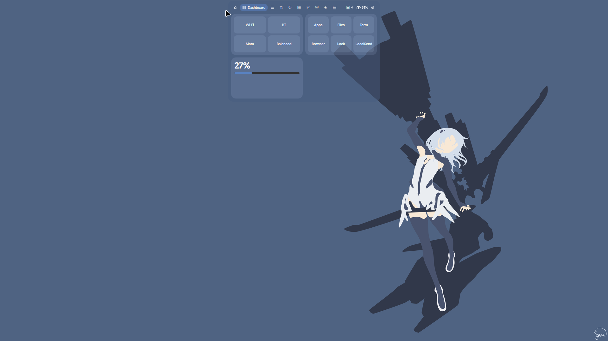 |

| Settings | Notification |
| --- | --- |
| 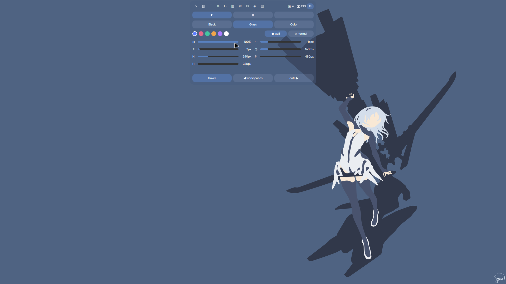 | 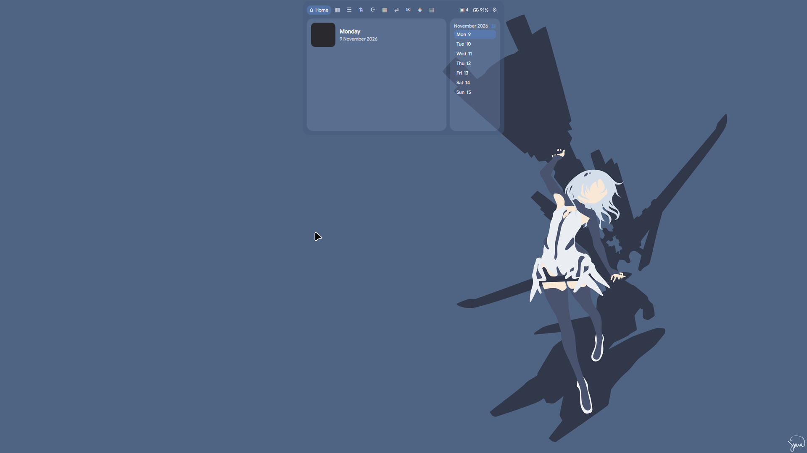 |

### Feature screenshots

Each available feature tab is captured separately below.

| Feature | Screenshot | Feature | Screenshot |
| --- | --- | --- | --- |
| Home |  | Dashboard |  |
| Control | 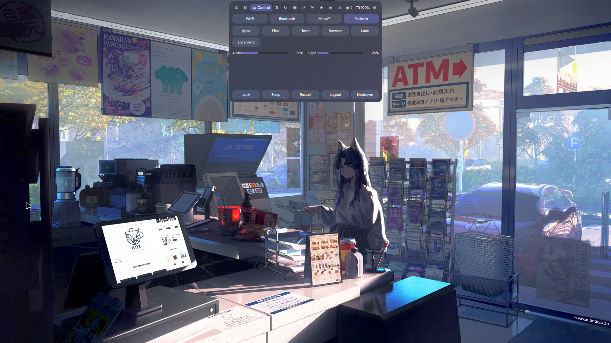 | Wi-Fi & Bluetooth |  |
| Todo | 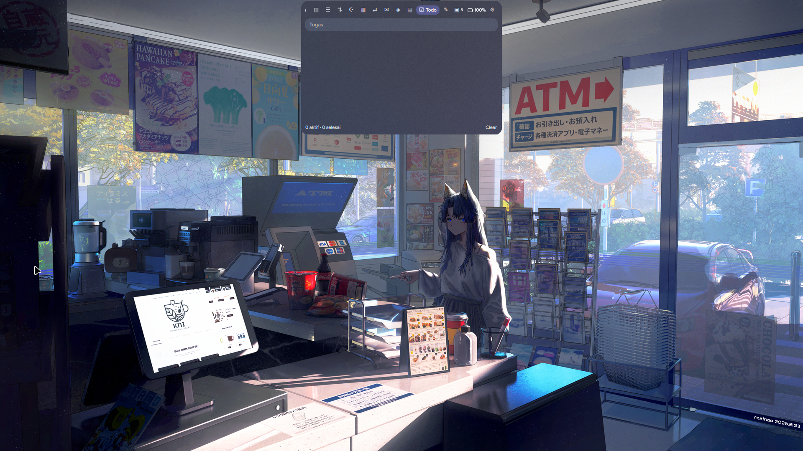 | Notes |  |
| Pomodoro | 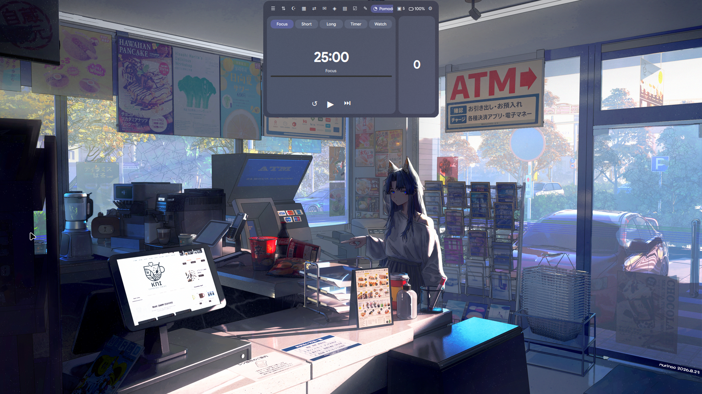 | Weather |  |
| Prayer Times | 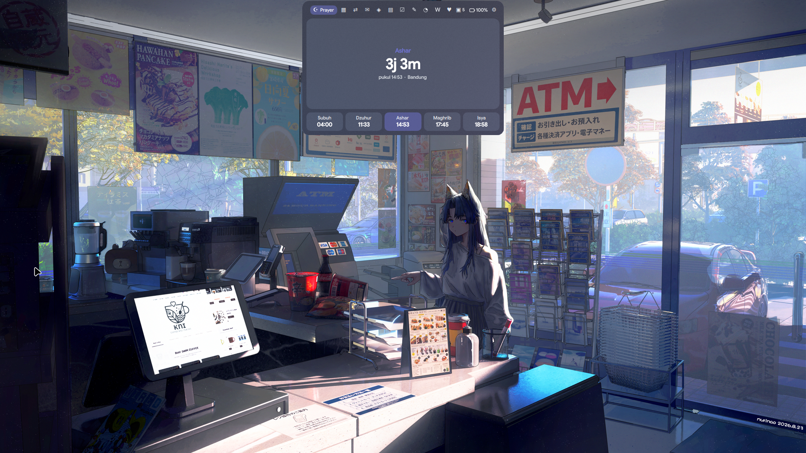 | Health | 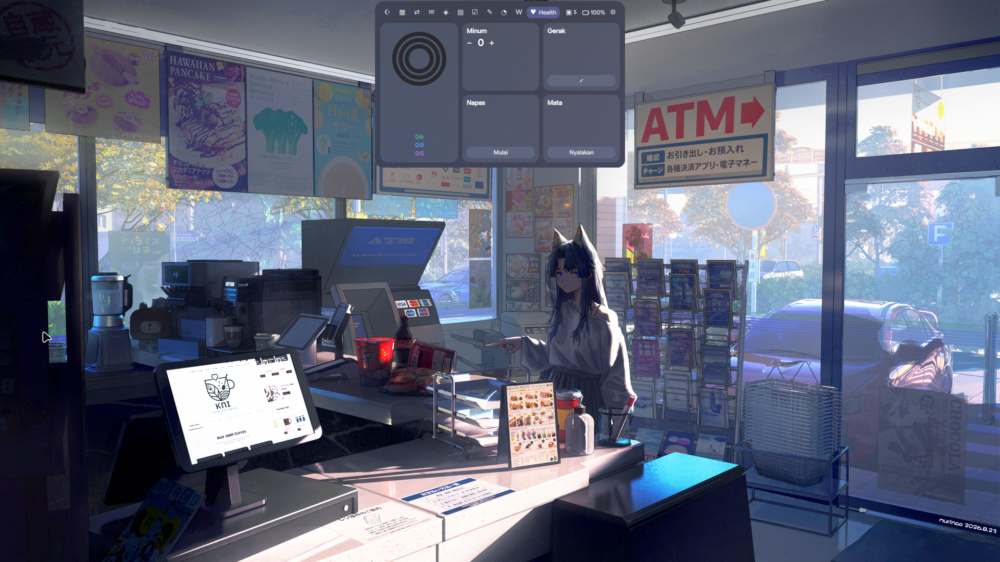 |
| Day | 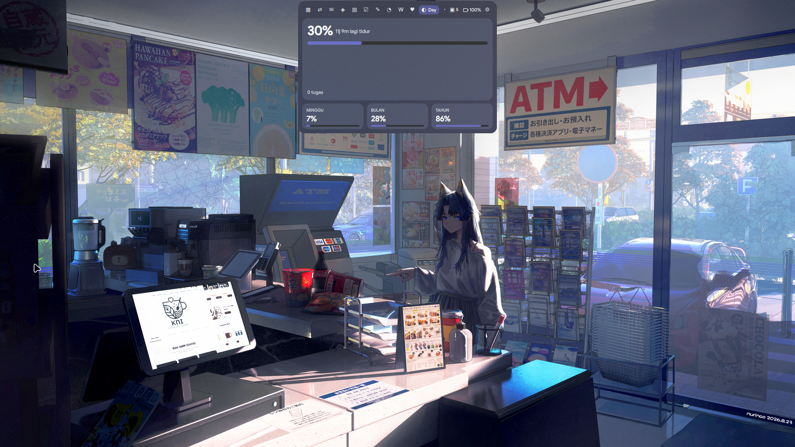 | Calendar |  |
| AI Chat |  | Translate |  |
| Shelf |  | Notifications | 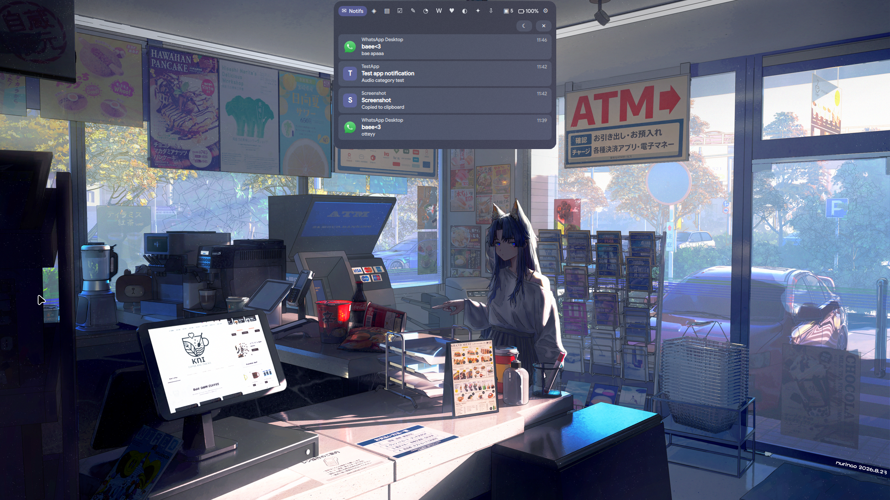 |
| GitHub PRs |  | Screen Time |  |
| System |  | Buddy |  |
| Settings | 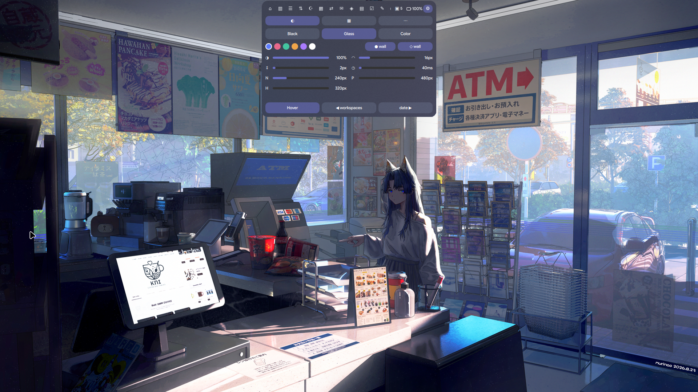 | Tray |  |

### Media, visualizer, and notification states

Media playback keeps the album art, CAVA visualizer, and synchronized lyrics
in separate compact slots so they do not overlap. Notification sounds are
classified by event: normal app messages use `message-new-instant`, warnings
use `dialog-warning`, errors use `dialog-error`, and screenshot/capture
events use `complete`. Screenshot notifications are logged without opening a
toast by default, preventing the capture notification from appearing in the
next screenshot; this can be enabled in Settings as **Popup screenshot**.

| State | Screenshot | State | Screenshot |
| --- | --- | --- | --- |
| Media notch with CAVA |  | Notification popup |  |
| Volume HUD |  | Brightness HUD |  |

The project is inspired by [Ponarch](https://ponarch.web.id/) and [Ponarch for
Windows](https://github.com/liimalim/Ponarch), but is an independent
implementation designed for the Linux desktop.

> Indonesian documentation: [README.id.md](README.id.md)

## Features

Ponarch has two main interface states: a compact notch for frequently
used information and an expanded interface containing additional tools
and modules.

### Compact Notch

-   Clock and date.
-   Now-playing information and album artwork.
-   Audio visualizer powered by CAVA.
-   Synchronized lyrics.
-   Pomodoro progress indicator.
-   Volume and brightness HUD.
-   Desktop notification popups.

### Expanded Interface

Tabs can be disabled and reordered to fit your workflow.

  -----------------------------------------------------------------------
  Tab                                 Description
  ----------------------------------- -----------------------------------
  Home                                Music player and calendar with
                                      weekly or monthly views.

  Dashboard                           Overview of desktop information.

  Control                             Quick controls and configurable
                                      application launchers.

  Wi-Fi & Bluetooth                   Network and Bluetooth controls.

  Todo                                Task and to-do management.

  Notes                               Quick notes.

  Pomodoro                            Focus timer and session tracking.

  Weather                             Location-based weather information.

  Prayer Times                        Prayer schedules based on location
                                      and calculation method.

  Health                              Personal health-related
                                      information.

  Day                                 Daily overview.

  Calendar                            iCal and Google Calendar
                                      integration.

  AI Chat                             Configurable AI chat interface.

  Translate                           Translation utility.

  Shelf                               Drag-and-drop file shelf.

  Notifications                       Notification history and controls.

  GitHub PRs                          Pull request overview using GitHub
                                      CLI.

  Screen Time                         Application usage tracking.

  System                              Resource monitoring with compact
                                      bars or detailed numbers.

  Buddy                               Desktop companion.

  Tray                                System tray applications and
                                      context menus.
  -----------------------------------------------------------------------

### System Tray

-   Left-click to activate an application.
-   Right-click to open its context menu, including submenus.
-   Middle-click to trigger the secondary action.

### Notification Daemon

Ponarch can act as the desktop notification daemon, replacing services
such as SwayNC, Mako, or Dunst.

Supported functionality includes:

-   Application icons and images.
-   Notification action buttons.
-   Do Not Disturb mode.
-   Notification popups integrated with the notch.

Notification sounds use the desktop `message-new-instant` sound and can be
enabled or disabled with `"notifSound": true` in
`~/.config/ponarch/settings.json` or from Settings.

Stop existing notification daemons before enabling Ponarch as the
primary daemon. To keep an existing daemon, set `"notifDaemon": false`.

### Location Services

Weather and prayer time information can use approximate IP-based
location or a manually configured location.

Manual locations accept:

-   Google Maps links.
-   Latitude and longitude coordinates.
-   Place names resolved through OpenStreetMap Nominatim.

### Themes and Appearance

Ponarch includes three visual themes:

-   **Black** --- a dark, minimal appearance.
-   **Glass** --- translucent surfaces with blur effects.
-   **Color** --- accent-driven styling.

Accent colors can be derived from the current wallpaper. Glass tint can
also adapt to the wallpaper or currently focused application.

------------------------------------------------------------------------

## Requirements

  -----------------------------------------------------------------------
  Component                           Requirement
  ----------------------------------- -----------------------------------
  Compositor                          Hyprland

  Shell runtime                       Quickshell (`quickshell`,
                                      `quickshell-git`, or a compatible
                                      fork)

  Qt                                  Quickshell must be built against
                                      the Qt version installed on your
                                      system.

  Required tools                      `bash`, `curl`
  -----------------------------------------------------------------------

Ponarch uses `Quickshell.Hyprland`. Other Wayland compositors are not
currently supported.

### Optional Dependencies

  Package                   Purpose
  ------------------------- --------------------------------------------
  `brightnessctl`           Display brightness control
  `networkmanager`          Network management
  `power-profiles-daemon`   Power profile integration
  `libnotify`               Notification compatibility
  `imagemagick`             Wallpaper and application color extraction
  `python`                  Google Calendar integration
  `github-cli`              GitHub pull request integration
  `localsend`               Local file sharing
  `waybar`                  Waybar integration for `ponarch mode`
  `zip`, `libarchive`       Archive handling
  `zenity`                  Graphical dialogs

**Qt compatibility matters.** If Quickshell reports that it was built
against a different Qt version than the one installed on your system,
rebuild or reinstall Quickshell against the current Qt installation. A
version mismatch can cause crashes.

------------------------------------------------------------------------

## Installation

### Arch Linux

Build the package from the current source:

``` bash
cd ~/Downloads
tar xf ponarch-quickshell-1_0_0-20.tar.gz
cd ponarch
grep pkgrel PKGBUILD
makepkg -si
```

Start Ponarch:

``` bash
pkill -f 'qs.*-p /usr/share/ponarch' 2>/dev/null || true
ponarch start
```

After installation, add the keybindings from:

``` text
/usr/share/doc/ponarch/hypr-ponarch.conf
```

to your `hyprland.conf`.

If upgrading from the old package, stop its runtime before starting the
new one:

``` bash
pkill -f 'qs.*-p /usr/share/poni' 2>/dev/null || true
ponarch start
```

### Laptop keys and lid behavior

Brightness keys use Ponarch IPC with `brightnessctl` as a fallback. The
`XF86Display` key toggles Ponarch/Waybar mode when firmware exposes
Fn+F5 as that key symbol. If Fn+F5 emits another symbol, inspect it
with `wev` and add the matching symbol to the Hyprland keybind.

The recommended logind policy is:

```ini
HandleLidSwitch=suspend
HandleLidSwitchExternalPower=suspend
HandleLidSwitchDocked=suspend
```

Check the sensor and inhibitors with:

``` bash
cat /proc/acpi/button/lid/LID0/state
loginctl list-inhibitors
```

### Other Distributions

For distributions without a package build:

``` bash
git clone https://github.com/hnxzl/ponarch.git
cd ponarch

mkdir -p ~/.local/share/ponarch
cp qml/* gcal.py ~/.local/share/ponarch/

install -Dm755 ponarch ~/.local/bin/ponarch
```

Start the application:

``` bash
PONARCH_DIR="$HOME/.local/share/ponarch" ponarch start
```

To avoid specifying `PONARCH_DIR` each time, export it in your shell
profile.

------------------------------------------------------------------------

## Commands

Ponarch provides a command-line interface for controlling the notch and
its services.

``` bash
ponarch start | stop | restart | notch | toggle | show | hide | vis
ponarch tab <name>
ponarch mode | localsend | gcal | edit | mem | status
```

  Command             Description
  ------------------- -----------------------------------------------
  `ponarch start`        Start Ponarch.
  `ponarch stop`         Stop Ponarch.
  `ponarch restart`      Restart Ponarch.
  `ponarch notch`        Open or close the notch.
  `ponarch toggle`       Toggle notch visibility.
  `ponarch show`         Show the notch.
  `ponarch hide`         Hide the notch.
  `ponarch vis`          Control visibility.
  `ponarch tab <name>`   Open a specific tab.
  `ponarch mode`         Switch between full Waybar and Ponarch modes.
  `ponarch localsend`    Launch LocalSend integration.
  `ponarch gcal`         Configure Google Calendar integration.
  `ponarch edit`         Open the settings file.
  `ponarch mem`          Display memory usage based on PSS.
  `ponarch status`       Show application status.

Available tab names:

``` text
home dash control net todo notes pomo weather prayer
health day cal ai trans shelf notif gh screen system
buddy tray settings
```

Examples:

``` bash
ponarch tab tray
ponarch tab weather
ponarch tab settings
```

The notch can also be toggled using a Hyprland keybinding. The suggested
default binding is `Alt+N`.

------------------------------------------------------------------------

## Configuration

Most settings can be managed through the Settings tab.

The configuration file is located at:

``` text
~/.config/ponarch/settings.json
```

When starting after an upgrade, Ponarch copies an existing
`~/.config/poni/settings.json` into the new location once so user
preferences are preserved.

Open it using:

``` bash
ponarch edit
```

### Available Settings

  -----------------------------------------------------------------------
  Key                                 Description
  ----------------------------------- -----------------------------------
  `mode`                              Visual theme: Black, Glass, or
                                      Color.

  `accent`                            Accent color.

  `glassOpacity`                      Glass surface opacity.

  `radius`                            Interface corner radius.

  `gap`                               Spacing between interface elements.

  `notchWidth`                        Width of the collapsed notch in pixels.

  `panelWidth`                        Width of the expanded control panel.

  `panelHeight`                       Height of the expanded control panel.

  `weatherDashboard`                 Show or hide the weather tile on
                                      Dashboard without disabling the
                                      Weather tab.

  `leftSlot`                          Left-side content in the collapsed
                                      notch.

  `rightSlot`                         Right-side content in the collapsed
                                      notch.

  `homeCal`                           Calendar layout: `week` or `month`.

  `sysDetail`                         System tab display: `false` for
                                      bars, `true` for detailed numbers.

  `autoLocation`                      Enable or disable automatic
                                      IP-based location.

  `prayerMethod`                      Aladhan calculation method.
                                      Default: `20` (Kemenag Indonesia).

  `launchers`                         Custom application launchers in the
                                      Control tab.

  `tabs`                              Enabled tabs and their display
                                      order.

  `aiProvider`                        AI service provider.

  `aiModel`                           AI model identifier.

  `aiBase`                            AI service base URL.
  -----------------------------------------------------------------------

### Notch Slots

The left and right sides of the collapsed notch can display different
information.

Available slot types include:

``` text
workspaces
battery
date
pomodoro
prayer
weather
event
```

### Custom Launchers

The Control tab supports custom launchers through the `launchers`
configuration.

Example:

``` json
{
  "launchers": [
    {
      "label": "Terminal",
      "cmd": "kitty"
    },
    {
      "label": "Browser",
      "cmd": "brave"
    }
  ]
}
```

### Location Configuration

Automatic location detection uses:

1.  `ipwho.is`
2.  `ipapi.co` as a fallback

IP-based geolocation generally provides city-level accuracy and may be
affected by VPNs or network routing.

For a manually configured location, set:

``` json
{
  "autoLocation": false,
  "city": "Bandung",
  "lat": -6.9175,
  "lon": 107.6191
}
```

You can also provide a Google Maps link, coordinates, or a place name in
the Prayer tab. Place names are resolved through OpenStreetMap
Nominatim.

### Prayer Time Calculation

Prayer schedules use the Aladhan API.

The default calculation method is:

``` json
{
  "prayerMethod": 20
}
```

Method `20` corresponds to Kementerian Agama Republik Indonesia. Change
this value according to your location and preferred calculation method.

### AI Chat

Ponarch supports the following configurable AI providers:

``` text
claude
gemini
openai
ollama
```

Configure the provider, model, and base URL through the settings.

Store your API key in:

``` text
~/.config/ponarch/ponarch.env
```

Example:

``` bash
PONARCH_AI_KEY=your_api_key
```

Keep this file private and do not commit it to version control.

------------------------------------------------------------------------

## Google Calendar Integration

Ponarch can integrate with Google Calendar and display calendar events
from the notch.

Initialize the integration:

``` bash
ponarch gcal
```

Follow the setup prompts.

Requirements:

1.  Create a Google Cloud project.
2.  Enable the Google Calendar API.
3.  Configure an OAuth client with the **Desktop app** application type.
4.  Complete the OAuth authorization flow.

For longer-lived authorization, configure the OAuth consent screen
appropriately. Google may revoke refresh tokens under certain
conditions, so authorization is not guaranteed to remain valid
indefinitely.

Alternatively, add a private iCal URL through the `calendars`
configuration.

Treat private iCal URLs as credentials. Do not share them publicly.

------------------------------------------------------------------------

## Resource Usage

Ponarch is designed to limit background activity when features are not
in use.

-   Only the active tab is loaded. Tab contents are unloaded when the
    notch closes.
-   Background tasks are started only for enabled features.
-   CAVA runs only while music is playing and the notch is collapsed.
-   Weather and prayer timers run only when their information is
    displayed in a slot.
-   Calendar timers start only when calendar integration is configured.
-   Screen-time data is written only when relevant values change.
-   Brightness is polled at two-second intervals.
-   A single fallback timer is used for the visualizer.

### Optional Software Rendering

Software rendering can be enabled experimentally through:

``` bash
PONARCH_SOFTWARE=1
```

Add it to:

``` text
~/.config/ponarch/ponarch.env
```

This disables the usual GPU rendering context in favor of software
rendering. It may not improve performance on every system.

### Measuring Memory Usage

Use:

``` bash
ponarch mem
```

The command reports memory usage based on proportional set size (PSS),
rather than relying only on resident memory.

------------------------------------------------------------------------

## Notes and Limitations

-   Hyprland is currently the only supported compositor.
-   Some interface labels and prayer names are displayed in Indonesian.
-   Glass blur requires an appropriate Hyprland `layerrule`. Syntax
    depends on your Hyprland version; Ponarch also applies the rule at
    startup. The example is in `hypr-ponarch.conf`.
-   Ponarch can replace SwayNC, Mako, or Dunst as the notification
    daemon. Stop existing notification daemons first, or set
    `"notifDaemon": false` to listen without replacing the daemon.
-   iCal recurrence rule (RRULE) support is basic.
-   `TZID` values are currently interpreted as local time.
-       Status icons use bundled SVG assets so their appearance is consistent
    across fonts and desktop environments.
-   Ponarch is intended as a compact desktop interface, not a full
    replacement for every Waybar module.

------------------------------------------------------------------------

## Credits

Ponarch is an independent project inspired by:

-   [Ponarch](https://ponarch.web.id/) --- the original project and design
    inspiration.
-   [Ponarch for Windows](https://github.com/liimalim/Ponarch) --- the Windows
    implementation that helped shape the notch concept.

Ponarch is not affiliated with or endorsed by the original Ponarch project.

## License

Ponarch is intended to be open-source software under the [MIT
License](LICENSE).

The repository should include the complete MIT License text in a
`LICENSE` file. Add the copyright holder's preferred name and the
applicable year before publishing.
